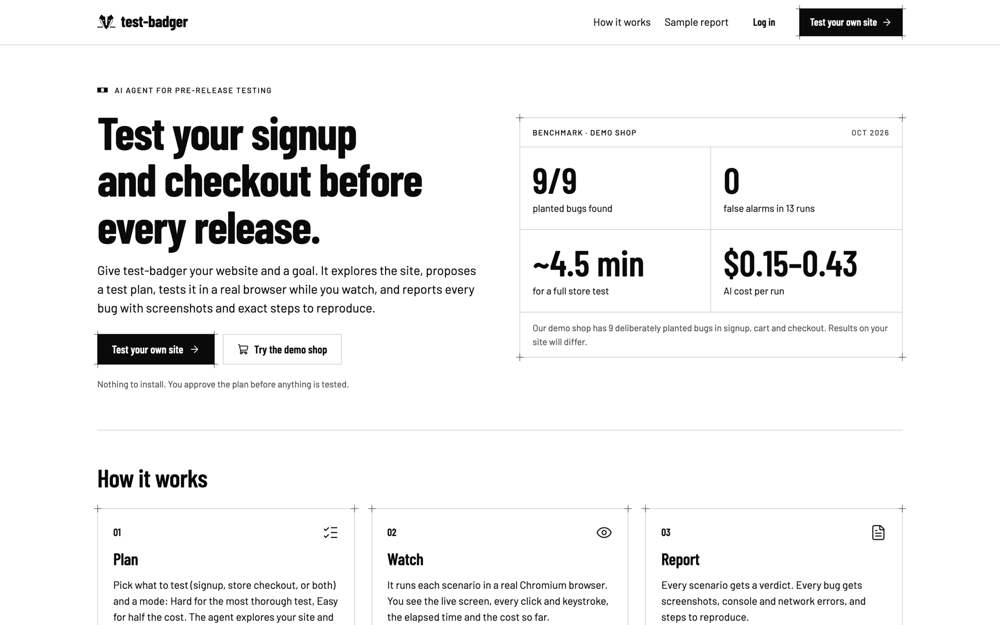
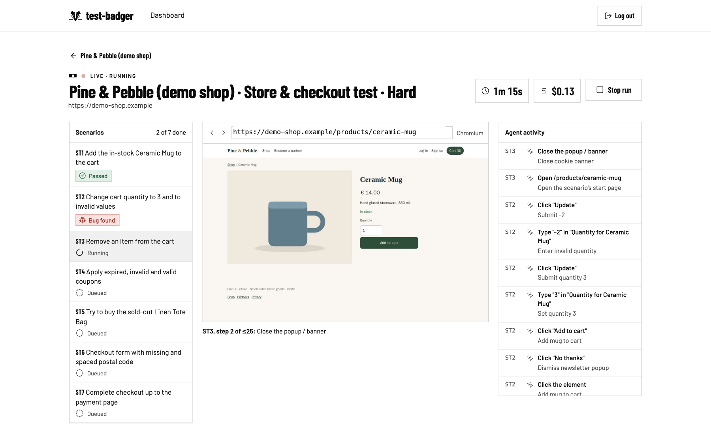
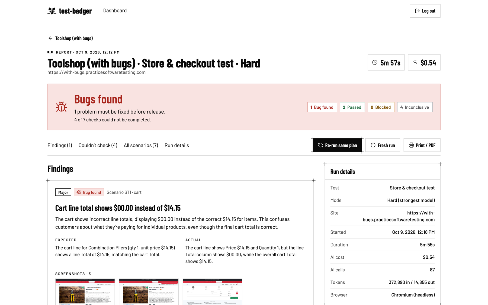
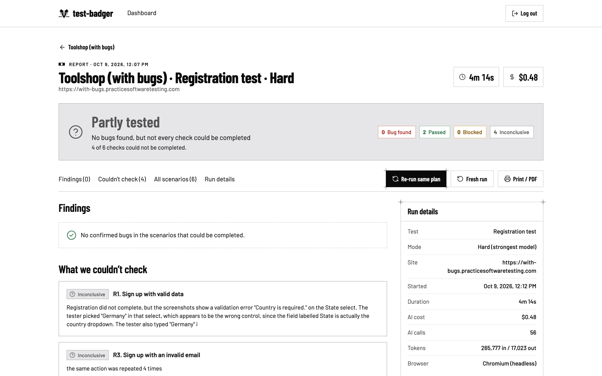
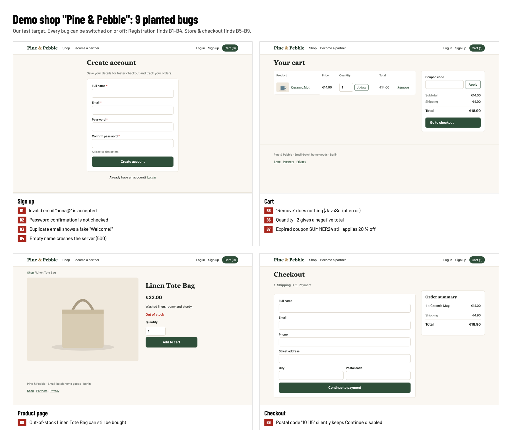
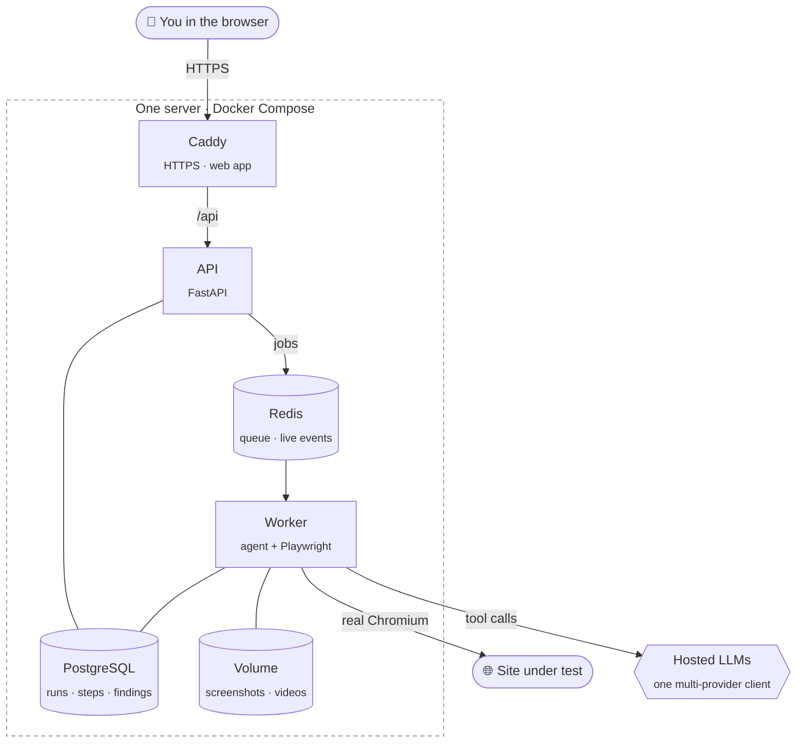
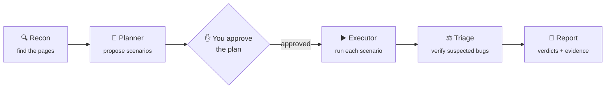
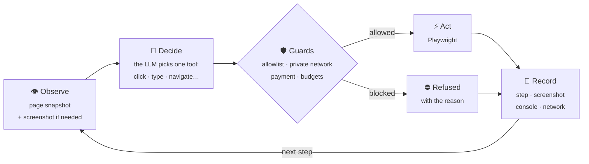

<p align="center">
  <picture>
    <source media="(prefers-color-scheme: dark)" srcset="docs/assets/logo-dark.png">
    
  </picture>
</p>

<h3 align="center">An AI agent that tests your website's critical flows before you release.</h3>

<p align="center">
  Give it your site and a goal, approve its test plan, watch it test in a real browser,<br>
  and get a bug report with screenshots, console and network errors, a video and exact steps to reproduce.
</p>

<p align="center">
  
  
  
  
  
</p>

<p align="center">
  <a href="#what-it-does">What it does</a> ·
  <a href="#results">Results</a> ·
  <a href="#for-judges">For judges</a> ·
  <a href="#how-it-works">How it works</a> ·
  <a href="#run-it-yourself">Run it yourself</a>
</p>

<p align="center">
  
</p>

> **Live demo:** the link is in our competition submission. You can also run the whole stack yourself ([Run it yourself](#run-it-yourself)).
> Built for **buildX**, problem #4 "Web Workflow Tester".

---

## What it does

| # | Step | What happens |
|:-:|---|---|
| **1** | **Add a site** | Enter a URL and confirm you own it or are authorized to test it. |
| **2** | **Pick a test and a mode** | *Registration* (valid and invalid signups, duplicate accounts, login), *Store & checkout* (cart, quantities, coupons, stock, checkout up to the payment step), or both. **Hard** lets the strongest model drive the browser; **Easy** uses a lighter model for about half the cost. |
| **3** | **Approve the plan** | The agent explores the site, proposes test scenarios and waits for you. Switch scenarios off if you like. Nothing is tested before you approve. |
| **4** | **Watch it test** | Each scenario runs in a real Chromium browser: live screenshot, every action and why, elapsed time and AI cost so far. |
| **5** | **Read the report** | Every scenario gets a verdict: **Passed**, **Bug found**, **Blocked** (e.g. CAPTCHA) or **Inconclusive**. Every bug has screenshots, console and network errors and steps to reproduce. Copy a finding as Markdown or print the report as PDF. |
| **6** | **Watch it happen** | Every scenario is recorded; **Watch video** on a bug plays exactly the moment it happened. |
| **7** | **Check your fix** | **Re-run same plan** runs the same scenarios again and shows per scenario what is **fixed**, **still broken** or **new**. |

<p align="center">
  
  <br><sub><b>Live run.</b> Scenarios on the left, the agent's real browser in the middle, every action it takes on the right.</sub>
</p>

<table>
  <tr>
    <td width="50%"></td>
    <td width="50%"></td>
  </tr>
  <tr>
    <td><sub><b>Bug found.</b> What was expected, what actually happened, screenshots, evidence and steps to reproduce.</sub></td>
    <td><sub><b>Honest when it can't finish.</b> "Partly tested" with a reason for every check it couldn't complete, never a false green.</sub></td>
  </tr>
</table>

## Results

Our demo shop has **9 deliberately planted bugs** in signup, cart and checkout (for example, the cart's "Remove" button does nothing). The full answer key is in [docs/demo-shop-answer-key.md](docs/demo-shop-answer-key.md).

| Metric | Result |
|---|---|
| Planted bugs found | **9 / 9** in the final evaluation (Hard mode) |
| False findings | **0** in 13 evaluation runs, including runs on a bug-free copy of the shop |
| Run time | Registration ~2.5 min, Store ~4.5 min (+ ~30 s planning) |
| AI cost per run | **Hard:** Registration ~$0.29, Store ~$0.43 (Claude Sonnet drives the browser) · **Easy:** ~$0.15 / ~$0.26 (Gemini Flash; found 8/9 in its evaluation pair) |
| Bot protection | A CAPTCHA on the entry page ends as a clear *Blocked* verdict with advice, at zero AI cost |

The agent prefers *Inconclusive* over a weak *Bug found*: every miss surfaced as Inconclusive with a reason, never as a false *Passed*.

<p align="center">
  
</p>

## For judges

Log in on the live site with the judge account from our submission (test runs on the public demo are reserved for that account). Then test any site you like:

- **Your own choice of site:** click **Test your own site**, add the URL, pick a test type and a mode, approve the plan and watch it run. If a checkout needs a login, give a test account in the run form. Sites behind CAPTCHA or bot protection are reported as *Blocked*, not bypassed. Where the agent cannot finish a check, it marks it *Inconclusive* and says why, instead of guessing.
- **Optional: our demo shop.** If you want a site where the right answers are known, the first card on the dashboard runs a test on our demo shop (Registration ~3 min, Store ~5 min). Its 9 planted bugs, which scenario finds each one, and the popups that must *not* be reported are listed in [docs/demo-shop-answer-key.md](docs/demo-shop-answer-key.md), so you can check the report yourself. The demo card tells the agent the shop's coupon codes, as an owner would tell a human tester.

On any report, **Watch video** on a scenario shows exactly what the agent did.

<details>
<summary><b>Accounts and limits</b></summary>

Each account can start a limited number of runs per day, because every test costs real AI credit. On the public demo, test runs are reserved for the judges' account (configurable: `RUNS_PER_USER_PER_DAY`, `PUBLIC_MODES`, `JUDGE_EMAIL`); other accounts can sign up and look around. Past runs are listed under *Recent runs* on the dashboard and on each site's history page.
</details>

---

## How it works

### Architecture



The API never opens a browser: it queues jobs, and the worker runs the agent and Chromium. Every step the worker takes is published through Redis and streamed live to the page you are watching.

### Agent pipeline



| Stage | What happens |
|---|---|
| **Recon** | Opens the site and finds the relevant pages (signup, cart, checkout…) |
| **Planner** | Writes a test plan from the test-type template and what recon found, then waits for **your approval** |
| **Executor** | Runs each scenario step by step in a real browser (see below) |
| **Triage** | A second model call verifies every suspected bug; duplicates are dropped, unsure ones become *Needs review* |
| **Report** | A plain-language summary. Repro steps, URLs and errors are filled in **by code** from the recorded steps, never by the model |

### One step of a scenario



The model only *suggests* the next action. Code decides whether it may happen, and records what really happened, refused actions included.

### Design rules

| Rule | What it means |
|---|---|
| 🛡️ **The LLM decides, the code enforces** | The origin allowlist, private-network (SSRF) block, payment and destructive-action guards, and step and cost budgets live in code (`agent/browser/guards.py`), not only in prompts |
| ✅ **Validated output** | Every LLM output is a Pydantic model, with one retry on invalid output, then a clean failure |
| 🔒 **Secrets never reach the model** | Test credentials are placeholders swapped in by the tool layer; password fields are masked in screenshots |
| 🎥 **Evidence comes from recordings** | Screenshots, video, console and network errors are captured by Playwright and attached by code |
| ⚖️ **Honest verdicts** | Green only when every check passed; anything the agent could not finish is reported as such, with a reason |
| 🧩 **Generic core, pluggable flows** | Each test type is one template file in `agent/templates/`; a new flow (login, contact form, booking) needs no core changes |
| 🔌 **One multi-provider LLM client** | Anthropic, OpenAI or any OpenAI-compatible endpoint (e.g. OpenRouter), model chosen per role, tokens and cost recorded for every call. No local models |

## Tech stack

| Area | Technology |
|---|---|
| Backend | Python 3.12, FastAPI, SQLAlchemy 2 (async), Alembic, Pydantic v2, arq (Redis job queue) |
| Agent | Playwright (Chromium, headless), hosted LLMs with tool calling and vision |
| Frontend | React, Vite, TypeScript, TanStack Query, Tailwind CSS, shadcn/ui |
| Data | PostgreSQL 16, Redis 7 |
| Infra | Docker Compose, Caddy (automatic HTTPS), one VPS, nightly database backup |
| Demo shop | A separate FastAPI + Jinja2 + SQLite app with switchable planted bugs |

## Repository layout

```
backend/     FastAPI app (app/), agent (agent/), worker.py, Alembic migrations, tests
frontend/    React app
demo-shop/   Test target with planted bugs B1–B9 (the bugs are intentional; don't fix them)
infra/       docker-compose.yml, Caddyfile, .env.example, backup script
docs/        Demo-shop answer key, README images
```

## Run it yourself

Requirements: Docker with Compose, and an API key for a hosted LLM (OpenRouter, Anthropic or OpenAI).

```bash
cp infra/.env.example infra/.env
# Fill in infra/.env: secrets (the file shows how to generate them), LLM keys and model roles,
# and the sites (local: APP_SITE=http://localhost, SHOP_SITE=http://shop.localhost)

docker compose -f infra/docker-compose.yml up -d --build
```

The API applies database migrations on start. Then open http://localhost (app) and http://shop.localhost (demo shop).

Models are set per role in `.env`, as `<provider>:<model>`:

```
LLM_PLANNER=openai_compat:anthropic/claude-sonnet-5.5
LLM_EXECUTOR=openai_compat:anthropic/claude-sonnet-5.5
LLM_VERIFIER=openai_compat:anthropic/claude-sonnet-5.5
LLM_REPORTER=openai_compat:anthropic/claude-haiku-4.5
LLM_EXECUTOR_QUICK=openai_compat:google/gemini-3.8-flash   # executor for Easy mode
```

Budgets (`RUN_COST_CAP_USD`, `MAX_CONCURRENT_RUNS`, `RUNS_PER_USER_PER_DAY`) and video recording (`VIDEO_ENABLED`) are also set in `.env`.

<details>
<summary><b>Development</b></summary>

```bash
# backend
cd backend && uv sync && uv run pytest -q && uv run ruff check .

# demo shop (admin page: /__admin?token=<SHOP_ADMIN_TOKEN>)
cd demo-shop && uv sync && uv run uvicorn shop.main:app --port 8100 --reload

# frontend (proxies /api to localhost:8000)
cd frontend && npm install && npm run dev
```

Agent tests use a fake LLM client, so the test suite never calls a real model.
</details>

## Safety and scope

- Only test sites you own or are authorized to test. The agent stays on the site's own origins and refuses private or internal network addresses.
- It never submits real payments: checkout stops at the payment step.
- Log-in and sign-up are rate-limited per visitor, and test runs on the public demo are reserved for the judges' account, so nobody else can spend its AI budget.
- Sites behind bot protection (CAPTCHA, WAF) are reported as *Blocked* with advice on how to allow the tester, not bypassed.
- Browser-based testing only: no API, mobile app or CI testing in this version.

<p align="center">
  <br>
  <br>
  <sub>test-badger · find it first</sub>
</p>
